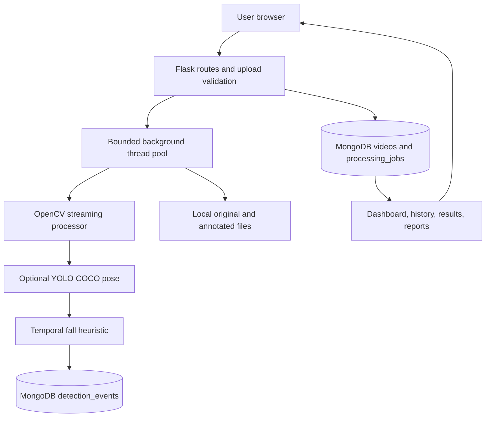
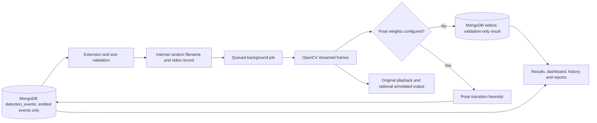

# Project Report: Web-Based Human Anomaly Detection System

> College report scaffold. Replace bracketed prompts with work you have actually performed. Do not invent evaluation values, screenshots, citations, or dataset outcomes.

## Abstract

This project presents a browser-based Flask application for local video analysis. It stores metadata/jobs/events in MongoDB, keeps videos on local storage, and runs work in a bounded background thread pool. Without optional pose weights, the system validates video metadata only. When YOLO pose weights are configured, a documented temporal heuristic may flag potential fall transitions; this research prototype has no validated accuracy claim.

## Introduction

Describe the context of human activity analysis, the motivation for a local educational prototype, and the importance of communicating model limits. Add only verified background sources.

## Existing and proposed systems

Describe relevant verified research and systems here. The proposed prototype provides upload validation and traceable local records, with an optional pose-based transition heuristic for one narrowly defined activity. Do not characterize it as a validated fall-recognition product.

## Problem statement

Create a beginner-accessible web workflow for handling video-analysis experiments and preserving their technical outcomes without presenting unsupported AI claims.

## Objectives

- Build a responsive Flask dashboard and upload workflow.
- Validate video readability and extract metadata using OpenCV.
- Optionally estimate COCO pose keypoints and apply an explainable fall-transition heuristic.
- Run long video analysis jobs in a bounded background queue and report progress.
- Persist video records and event rows in MongoDB.
- Provide searchable history and data-backed CSV reports.
- Clearly document capabilities, limitations, privacy, and future model validation needs.

## Literature review

Add a small set of verified papers or official model documentation. For each: record authors, title, publication venue/year, DOI or stable URL, dataset, method, and limitations. Read the original source. Do not copy claims from search snippets.

## System requirements

**Software:** Python 3.10+, Flask, OpenCV, NumPy, MongoDB, modern browser, VS Code (recommended).

**Hardware:** A laptop that can run Python and decode short videos. Validation-only mode does not require a GPU. Optional pose inference requires the configured Ultralytics/PyTorch package and weights; CPU or supported CUDA hardware can be selected through PyTorch installation. Disk capacity must accommodate source and annotated files.

## Feasibility study

**Technical:** feasible as a local Flask/OpenCV application. Codec support varies. **Economic:** uses freely available open-source packages; verify licenses for future models. **Operational:** suitable for a classroom demonstration with consented, non-sensitive footage.

## Architecture

## Data flow diagram

## Database design

The `videos` collection stores filename, generated file reference, upload date, status, duration, FPS, dimensions, processing time and error. `processing_jobs` holds status, progress and timestamps. `detection_events` references a video ObjectId and stores category, video timestamp, nullable confidence, optional heuristic score, method and evidence metadata. Events are inserted only when the configured detector emits one.

## Module descriptions

- `app/routes`: page, upload, history, result and report endpoints.
- `app/services/video_processor.py`: bounded-frame OpenCV processing, metadata and optional annotated output.
- `app/services/fall_detector.py`: optional pose inference and upright/drop/persistence heuristic.
- `app/services/repository.py`: MongoDB data access and dashboard/report queries.
- `app/routes/videos.py`: upload and enqueue, worker lifecycle, result/media/status routes.
- `app/db.py`: MongoDB schema and connection helper.
- `app/templates` and `app/static`: Jinja pages, responsive styling and small interactions.

## Implementation

Explain the chosen local configuration, generated filenames, upload checks, database writes, and how actual dashboard values are queried. Include screenshots captured from your own running instance and describe the exact environment used.

## Testing and results

Workspace verification on 2026-10-18: `python -m compileall -q app tests` completed and `python -m pytest -q` reported **15 passed**. Tests use mongomock and synthetic videos/keypoints; this does not verify a live Atlas connection, downloaded model weights, model accuracy, or annotated codec support on every system. Re-run both commands in the final submission environment and record any differences.

## Limitations

The fall-transition heuristic has not been validated against a research dataset and is susceptible to missed events and false positives. It emits at most one event per video. The current simple pose association chooses the nearest detected pose center and can switch people in crowded scenes; it is not identity tracking. Fighting, general anomaly detection, logins/accounts, distributed worker recovery, and public-deployment hardening are not implemented. Annotated output depends on OpenCV codec support. Empty event counts do not imply normal activity.

## Conclusion and future scope

Summarize the working Mongo-backed video-management site and optional experimental fall-transition prototype. Future work should evaluate on consented labeled data, define event-level metrics, improve multi-person tracking, add account permissions, and use a durable external worker system before public deployment.

## References

Add only sources you verified directly. The optional model guide and licensing details are linked in README. Record the exact weight file/version you download and the license terms you reviewed. No dataset is bundled and no accuracy, dataset result or experiment is claimed.
